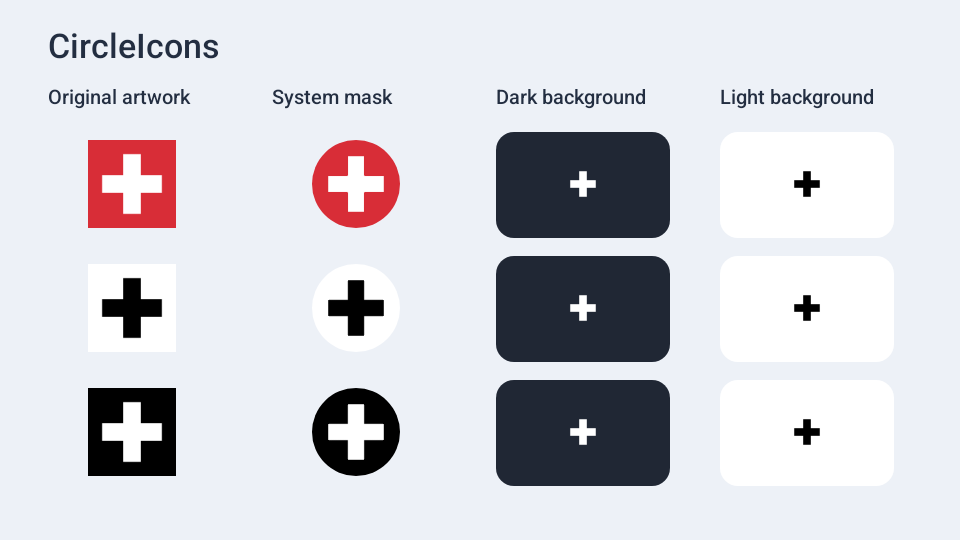

# CircleIcons

An Xposed module that brings legacy app artwork into Android's adaptive-icon pipeline and repairs opaque notification icons that would otherwise turn into solid blocks in the status bar. SystemUI retains control of light/dark and wallpaper-aware tinting.

**Requires root and a framework implementing the legacy Xposed API 82.** It is not an ordinary launcher/icon-pack APK and does not work on an unmodified, unrooted stock phone.

[Releases](https://github.com/Vickylines/CircleIcons/releases) · [中文](README.md) · [Compatibility evidence](docs/COMPATIBILITY.md)




## Coverage

- Launcher3 and the AOSP-derived Pixel Launcher icon path.
- App artwork in Settings, permission controllers, installers, DocumentsUI and resolvers.
- Shell splash icons where the icon-provider API exists.
- Opaque notification small icons, converted to transparent monochrome glyphs before SystemUI tinting.
- Per-package notification artwork invalidation on newer SystemUI implementations.

Newly installed apps use the same hooks; there is no per-app allowlist. Existing adaptive icons, user avatars, conversation avatars and animated/level-based notification icons are preserved. Profile badging remains Android's responsibility. The shape follows the ROM's adaptive-icon mask: choose a circular mask in your ROM to retain round icons.

## Install

Install a compatible Xposed framework, install the release APK, enable CircleIcons and select the recommended packages that exist on the device. Include SystemUI, the active launcher and Settings. Reboot to reload target processes after installation or upgrade.

For old framework resolvers running in `system:ui`, the framework's Android system scope may also be needed. CircleIcons explicitly excludes `system_server`. Do not clear launcher data just to refresh icons; this destroys the home-screen layout. Supported launcher caches are versioned by the module.

## Compatibility

3.0.0-beta.1 targets AOSP/Pixel/LineageOS-derived Android 8.1–17 (API 27–37) through capability detection. Unsupported features are reported independently rather than aborting all hooks. **This is not a guarantee of full support on every stock-like ROM.** Pixel Launcher's private/obfuscated variants require per-version validation; heavily customized OEM SystemUI and third-party launchers are outside the tested scope.

[The compatibility matrix](docs/COMPATIBILITY.md) distinguishes Android rendering tests, actual APK signature discovery and live Xposed execution. CI tests real Android graphics and signatures, but does not run Xposed.

## Build

JDK 17, Android SDK 36; Gradle 8.13 and Android Gradle Plugin 8.13.2 are pinned.

```sh
./gradlew :app:assemblePhoneRelease :app:lintPhoneRelease
./gradlew :app:assembleInspectionDebug :app:assembleInspectionDebugAndroidTest
python scripts/run_inspection.py --serial emulator-5554
```

Use `gradlew.bat` on Windows. Set `sdk.dir` in the ignored `local.properties`. For a non-ASCII Windows path, use an ASCII checkout or pass `"-Pandroid.overridePathCheck=true"`.

Release builds are unsigned unless `CIRCLE_KEYSTORE`, `CIRCLE_STORE_PASSWORD`, `CIRCLE_KEY_ALIAS` and `CIRCLE_KEY_PASSWORD` are supplied locally. No signing keys are stored in this repository. The inspection flavor uses a separate application ID and is not an Xposed module.

## License

Apache-2.0. AOSP/LineageOS monochrome generation retains upstream attribution; see [NOTICE](NOTICE.md). No network permission or telemetry.
