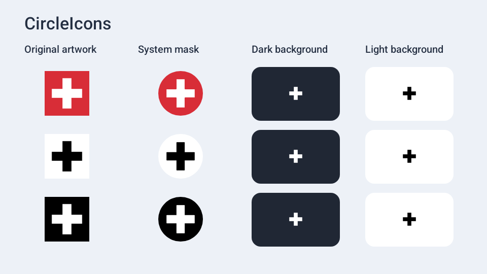

# CircleIcons

让老旧应用完美融入 Android 自适应图标，同时修复状态栏通知“白色方块”问题。

适用于 Android 8.1 - 17 的 AOSP、Pixel 以及 LineageOS 等类原生系统。

[下载 APK (Releases)](https://github.com/Vickylines/CircleIcons/releases) · [English](README.en.md) · [兼容性说明](docs/COMPATIBILITY.md)



## 它解决什么问题？

1. **老旧应用图标不规则**：很多未适配 Android 8.0+ 自适应图标的老应用，在桌面或抽屉里显得格格不入。本模块会自动为其生成规范的自适应圆形图标。
2. **状态栏通知显示为白色方块**：Android 要求通知小图标必须是透明底色的单色图标。很多国内或老旧 App 直接用了带底色的彩色小图标，导致在状态栏里变成一个实心的白色方块。本模块会自动提取其轮廓图案转为单色，让系统正常着色（支持跟随深浅色模式与主题壁纸变色）。

## 生效范围

- **桌面与抽屉**：Pixel Launcher、Launcher3 等原生桌面
- **系统界面**：设置、权限管理、应用安装器、文件管理器、系统分享面板
- **通知栏**：状态栏通知小图标（修复白块并正常变色）

> 注：模块仅处理未适配的老旧应用图标；本身已规范适配自适应图标的应用、动态日历/时钟、联系人头像等不受影响。

## 安装与使用

> **前置要求**：需要已 Root 并安装支持传统 Xposed API 的框架（如 LSPosed）。

1. 前往 [Releases](https://github.com/Vickylines/CircleIcons/releases) 下载并安装 `CircleIcons.apk`；
2. 在 LSPosed / 框架管理器中激活本模块；
3. 作用域勾选：**系统界面 (SystemUI)**、**当前桌面 (如 Pixel Launcher / Launcher3)**、**设置**；
4. 重启手机（或重启上述对应进程）即可生效。

*提示：如果桌面图标未及时刷新，重启一次桌面进程即可，无需清除桌面数据。*

## 兼容性

- 针对原生 / 类原生系统开发（AOSP、Pixel、LineageOS 及各种衍生 ROM）。
- 暂未适配 MIUI / HyperOS、One UI、ColorOS 等深度定制的国产厂商系统。
- 更多详细适配与测试记录请参见 [兼容性文档](docs/COMPATIBILITY.md)。

## 编译

需要 JDK 17 和 Android SDK 36。

```sh
./gradlew :app:assemblePhoneRelease
```

Windows 下使用 `gradlew.bat` 即可。

## License

[Apache License 2.0](LICENSE)
